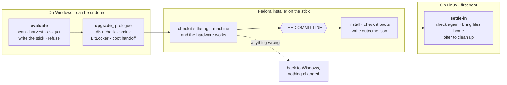

<div align="center">

# upgrade_

### Move your computer to Linux. One stick, one click, done.

Plug in a USB stick, pick a desktop, hit convert, and walk away. When you
come back it's a working Linux machine, with your files, Wi-Fi and browsers
still there. By default Windows doesn't get deleted either. It gets shrunk
and set to one side until you're sure you don't need it.

[](LICENSE)


[Why](#why) · [How it works](#how-it-works) · [Where it stands](#where-it-stands) ·
[The scanner](#the-scanner-evaluate) · [First principle](#first-principle) ·
[Roadmap](#roadmap) · [Contributing](#contributing)

</div>

> [!IMPORTANT]
> **Not ready for your machine yet.** One real laptop has gone from Windows
> to Fedora in one click with nobody touching it, on the "erase and keep
> nothing" path. It does not carry your files yet, and nothing is signed.
> Where every step stands, failures included: [docs/STATUS.md](docs/STATUS.md).

---

## Why

Your hardware should be yours to customize.

Windows 10 stopped getting security updates in October 2025. Tons of
perfectly good machines can't run Windows 11, but they run Linux just fine.
The machine was never the problem. The problem is knowing how: which
version of Linux, which BIOS setting, which driver is missing, and how to
not lose your photos on the way.

**This project knows all that so you don't have to.**

## How it works

There are three parts. They're split by one question: can this step still
be undone?



| Part | Runs on | What it does |
|---|---|---|
| **`evaluate`** | Windows, read-only | Looks the machine over and asks what you want. Grabs the stuff only Windows knows (where your folders are, the BitLocker key and so on), writes the stick, and says no to anything it can't do safely. |
| **`upgrade_`** | Windows → Linux | Does the actual move. Normally it shrinks Windows and puts Linux next to it. It only erases the disk if you ask it to. |
| **`settle-in`** | Linux | Makes sure the hardware works, copies your files over from the old Windows side, then gets out of your way. |

> [!NOTE]
> **Right now it only works from Windows.** Nothing about the idea (look,
> commit, settle in) needs Windows, but all the code today reads a Windows
> machine: PowerShell, `bcdedit`, BitLocker, `netsh`. Other systems may be supported in the future.

### The commit line

Every conversion has exactly one point of no return. Windows stays bootable
right up until then.

| Path | The point of no return | What protects you |
|---|---|---|
| **Keep Windows** (the default) | **Clean-up.** Once Linux is working and your files are confirmed, you choose to delete the old Windows part. Until you do, Windows is one pick away in the boot menu. | You decide, after Linux is already running |
| **Erase and install** | **The wipe.** The installer shows a **2-minute countdown** you can cancel. Until it hits zero, nothing on your disks has changed. | Its own launcher, a sentence you type out, and hardware checks that have to pass first |

That leads to two rules:

1. The screen says *"you can still cancel"* right up to that moment, and
   stops saying it the second it's crossed.
2. **Anything that might say no has to say it before the line.** After it,
   the only way back is a slow recovery, from a drive that might be the
   thing that's failing.

The full design is in [docs/architecture.md](docs/architecture.md).

---

## Where it stands

One real laptop, an Acer Aspire A515-51G with a dying drive, has done the whole
conversion for real: one click on Windows, nobody at the keyboard, a Fedora desktop
at the end with the clock set, Wi-Fi joined and remote access kept. It has gone back
to Windows the same way. Two runs failed first; both are in the record. One machine
is one data point, not proof. Every step, with the test row behind each bar:
[docs/STATUS.md](docs/STATUS.md). The story, run by run: [docs/log/](docs/log/).

---

## The scanner: `evaluate`

The scanner only looks, it never touches. It tells you if your machine can
switch to Linux, what'll break, which Linux to pick, and what to do first.
It doesn't change, encrypt, delete or send anything.

The most useful thing it tells you isn't yes or no. It's **the Linux kernel
version your hardware needs**, and which popular versions of Linux are too
old for it.

Here's why that matters. Beginners almost always get told to use Mint or
Ubuntu. On a laptop from 2024 or later, those can come with a kernel that's
too old for the Wi-Fi card. So you boot up, there's no Wi-Fi, you figure
Linux is broken, and you go back to Windows. Nothing was broken. You just
picked a version that's older than your laptop.

| Check | Why |
|---|---|
| **Intel RST / VMD** | With this switched on, Linux can't see your SSD at all. It looks like the installer is broken, but it's really one BIOS setting. It's the most common fake "Linux won't install". |
| **Drive health** | Reads the drive's health counters, the error log, the volume status and Windows' own check log. A dying drive is RED. |
| **Wi-Fi card** | Broadcom cards need a driver you'd have to download, with the internet you don't have yet. Newer MediaTek cards need kernel 6.7 or newer. |
| **Graphics** | New AMD chips need a recent kernel or you get a black screen. NVIDIA needs a Linux that installs its driver for you. |
| **Speaker amps** | On laptops with Cirrus or TI amps, headphones work but the built-in speakers stay silent. Really common since 2023. |
| **BitLocker** | Resize an encrypted disk without the recovery key and your data is gone for good. |
| **Fast Startup** | Windows secretly hibernates instead of shutting down, which makes the disk unsafe to resize. Clicking Shut down doesn't fix it. |
| **Free space** | Measured two separate ways (run as admin) to see which route fits your machine. |
| **Your programs** | Adobe, Office, CAD, games with anti-cheat. Sometimes the honest answer is "don't switch this one." |

Anything it doesn't recognise gets listed at the bottom of the report, so
you can send it in and help the next person.

### Try it

Download [`dist/upgrade-scan.ps1`](dist/upgrade-scan.ps1) and run this in
PowerShell:

```powershell
powershell -ExecutionPolicy Bypass -File .\upgrade-scan.ps1
```

```text
-Json          also save a JSON copy
-NoFile        just print it, don't save
-OutDir <path> save it somewhere other than the Desktop
-SelfTest      run the built-in tests
```

> [!TIP]
> **Run it as Administrator if you can.** Otherwise Windows won't say
> whether your disk is encrypted, and that's the one thing that can cost you
> everything. It still works without admin, it just won't give you a full
> green light and tells you why.

---

## First principle

> **If we can't do your machine safely, we say so and stop.**

**There's no way to skip a RED.**

There's one small exception, dated 2026-09-13 ([RISKS R23](docs/RISKS.md)).
If a machine gets turned down because of its drive, you can type out a
specific sentence on a separate launcher. That unlocks exactly two
refusals, drive health and volume health, and nothing else. From then on
every screen says **DATA LOSS ACCEPTED**. Making that exception any bigger
is exactly what this rule is here to stop.

When it says no, it tells you what would change its mind: how many GB to
free up, or what size stick you'd need. It'll still turn away machines with
Intel RST/VMD switched on, because that setting can't be changed safely from
software on every brand of laptop.

Yes, that means turning some people away. That's the right call. A tool
like this gets trusted once, and loses that trust forever the first time it
wipes someone's photos. So anything that writes to a disk has to meet a much
higher bar than the scanner. That's why those parts got built last, only
after the proof was in, and why every "no" gets tested harder than every
"yes".

What we don't know yet is all written down in [docs/RISKS.md](docs/RISKS.md),
and the plan for finding out is in [docs/VALIDATION.md](docs/VALIDATION.md).
Give both a read before trusting any single check.
A pass on the test rig (a virtual machine) only proves the plumbing: a
simulated machine is built from our own guess about the hardware, and that
guess is usually the thing being tested. Each risk says what needs real hardware.

---

## Roadmap

What we mean to build, in what order, what each step waits on, and the
decisions still owed: [docs/ROADMAP.md](docs/ROADMAP.md). Devices beyond Windows
PCs (old Surfaces, handhelds, Macs, TVs): [docs/research/](docs/research/).

---

## Working on it

Start with [CLAUDE.md](CLAUDE.md): the mission, the rules, the layout of the
repo and the working conventions. Run the scanner straight from
`evaluate/windows/upgrade-scan.ps1` (it loads `data/` from disk), or build
the single file with `./build.sh`.

The Windows side targets **Windows PowerShell 5.1**, because that is what
comes with every Windows 10 and 11 machine: no PowerShell 7 syntax (no
ternaries, no `??`, no `-Parallel`). It is being ported to Rust one piece at
a time; a script stays in use until its Rust twin has earned the same rows
([docs/RUST-PORT.md](docs/RUST-PORT.md)).

Before you open a pull request:
- both self-tests, from `evaluate/windows/`: `.\upgrade-scan.ps1 -SelfTest`
  and `.\Harvest-UpgradeState.ps1 -SelfTest`.
- `./port-check.sh` when the scanner, `data/` or `schemas/` changed. It fails
  when the Rust side no longer says what the PowerShell says.
- `./docs-check.sh` when any `.md` file changed. The docs change only through
  the docs skill ([.claude/skills/docs/SKILL.md](.claude/skills/docs/SKILL.md)):
  one home per fact, history in `docs/log/`, state in `docs/STATUS.md`, plans
  in `docs/ROADMAP.md`.

## Contributing

Check out [CONTRIBUTING.md](CONTRIBUTING.md). Adding a device is one line in
a table in `data/`, with a source ("it should work" isn't a source). That's
on purpose. The hardware list only gets good when lots of people add to it,
and it's what makes every future report better.

**The best thing you can do right now: run the scanner on your machine and
send the report.** Apart from the Aspire, every "no" has only ever been
tested with made-up machines.

## Licence

GPL-3.0, see [LICENSE](LICENSE).

The whole deal here is "read the code yourself", and GPL makes sure every
copy of it stays readable. The nightmare is someone making a closed copy
that quietly softens the safety checks while riding on this project's good
name. GPL-3.0 rules that out.
